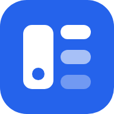
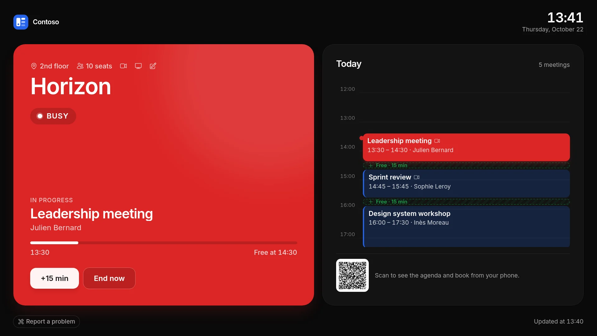
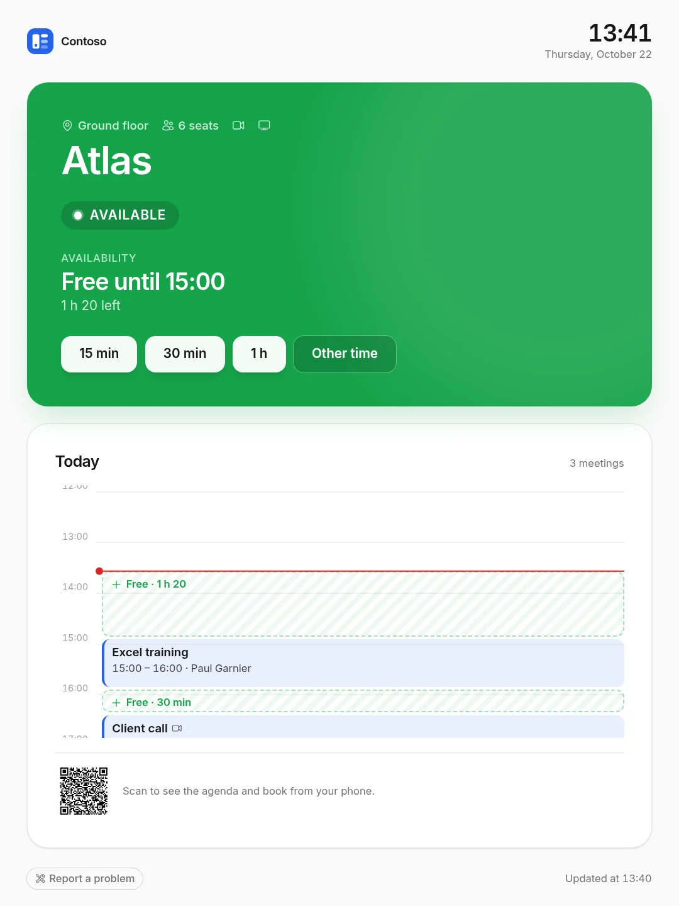
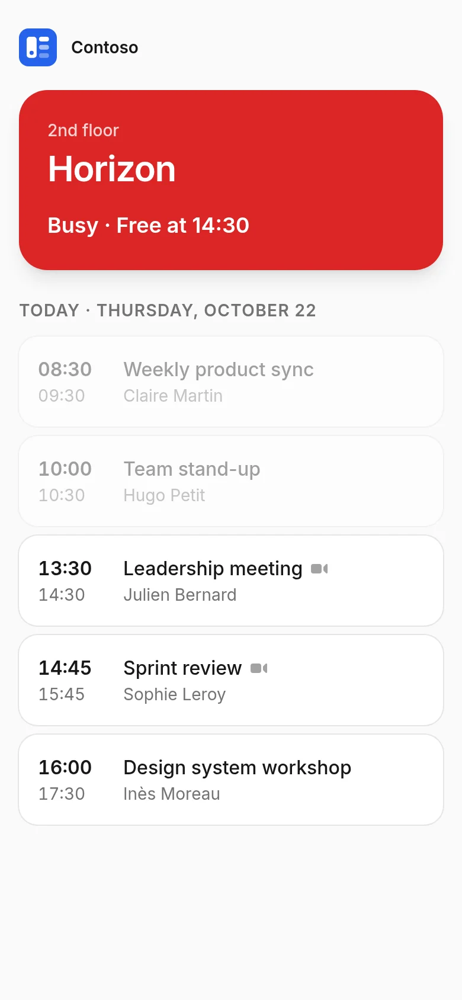
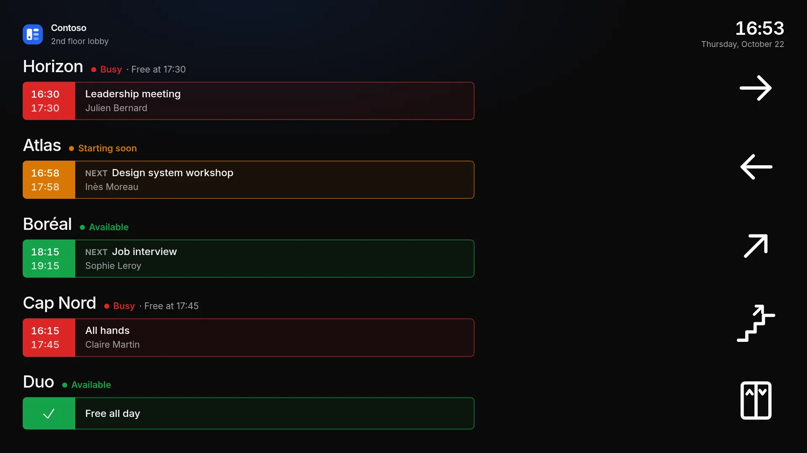
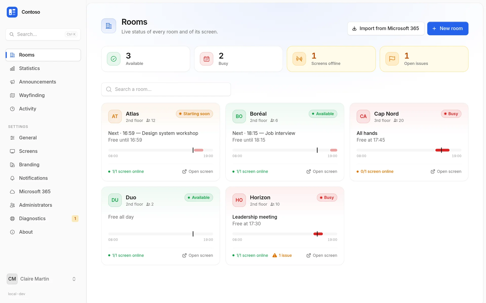
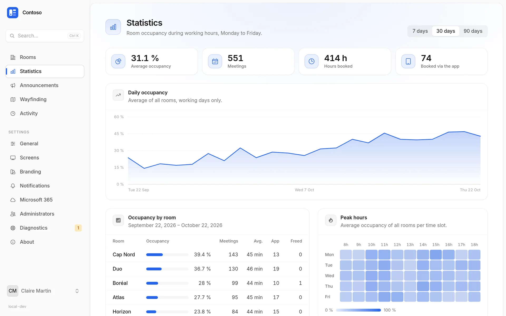
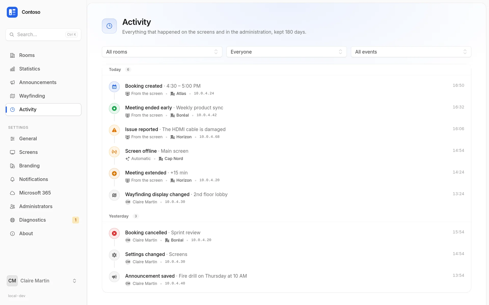

<div align="center">



# O365 Kiosk Resources

**Your Microsoft 365 meeting room agendas, displayed in front of every room.**<br />
Wall screens and tablets, on-site booking, full administration — in English and French.

[](https://github.com/pokertour/O365KioskResources/actions/workflows/ci.yml)
[](https://github.com/pokertour/O365KioskResources/actions/workflows/release.yml)
[](https://github.com/pokertour/O365KioskResources/tags)
[](LICENSE)


**[Website](https://pokertour.github.io/O365KioskResources/)** · [Releases](https://github.com/pokertour/O365KioskResources/tags) · [Docker image](https://github.com/pokertour/O365KioskResources/pkgs/container/o365kioskresources)

</div>

<p align="center">
  
</p>

<p align="center">
  
  &nbsp;&nbsp;
  
</p>

---

## Contents

- [Features](#features)
- [Quick start (Docker)](#quick-start-docker)
- [Connect Microsoft 365](#connect-microsoft-365)
- [Install a screen](#install-a-screen)
- [Administration](#administration)
- [Deployment](#deployment)
- [Development](#development)
- [Architecture](#architecture)
- [Troubleshooting](#troubleshooting)
- [License](#license)

---

## Features

### 📺 Room screens

- **Readable from across the hall**: *Available*, *Starting soon* or *Busy*, in your brand colours.
- **Today's agenda** as a proportional **timeline** ("now" line, free slots) or as a **list**.
- **On-site booking**: 15 / 30 / 60 min buttons, tap a free slot to book it, edit or cancel bookings made from the screen.
- **End or extend** the meeting in progress (+15 / +30 min when the room stays free).
- **Responsive**: landscape or portrait, text sized for the resolution and viewing distance.
- **Night mode** outside working hours, OLED burn-in protection, wake on touch.
- **Kiosk-proof**: keeps the screen awake, full screen, no zoom, recovers by itself after an outage.
- **Announcements** (fire drill, works…), room **equipment**, **report a problem**.
- **QR code** to a signed phone view to check the agenda and book.
- **Several screens per room**, each with its own link, supervision and settings.

### 🧭 Wayfinding displays (optional)

A screen for a lobby or a corridor: several rooms, whether they are free, the meeting in progress or the next one, and an arrow to each room — left, right, ahead, diagonals, upstairs, downstairs or elevator. More rooms than fit? The display turns the pages by itself.

<p align="center">
  
</p>

### 🛠️ Administration

- **Live dashboard**: status of every room, screens online, open issues.
- **Room import** from Microsoft 365, **screen pairing with a 6-digit code**.
- **Occupancy statistics** (7 / 30 / 90 days) and peak hours.
- **Activity log** (bookings, screens, settings…), kept 180 days.
- **Alerts** by e-mail and/or **Microsoft Teams** when a screen goes offline or a problem is reported.
- **Branding**: name, logo, colours, light or dark theme, with a live preview.
- **Settings** at global, room and screen level: language, time zone, time format, durations…
- **Administrator sign-in with Microsoft** (Entra ID SSO).
- **Diagnostics**: Microsoft 365 connection and permissions, scheduler, queue, disk space, agenda sync — with a report to copy.
- **⌘K / Ctrl+K palette** to jump to any page, setting or room.

<p align="center">
  
</p>

<p align="center">
  
  
</p>

### 🔒 Security

- Secret screen links, stored hashed and encrypted, **revocable** screen by screen.
- Administrator rights re-checked on every action; password confirmation for Microsoft settings.
- Security headers; screen pages served `no-referrer` / `no-store` / `noindex`; logo served with a sandboxing CSP.
- Microsoft secrets and tokens encrypted at rest; two-factor authentication available.

---

## Quick start (Docker)

An image is published to GitHub Container Registry for every release.

```bash
# 1. Generate an application key
docker run --rm ghcr.io/pokertour/o365kioskresources php artisan key:generate --show

# 2. Run the application (SQLite in a volume)
docker run -d --name rooms -p 8080:8080 \
  -e APP_KEY="base64:…" \
  -e APP_URL="http://localhost:8080" \
  -e RUN_MIGRATIONS=true \
  -v rooms-storage:/app/storage \
  ghcr.io/pokertour/o365kioskresources:latest

# 3. Create the first administrator
docker exec -it -e ADMIN_EMAIL=you@company.com -e ADMIN_PASSWORD='a-strong-password' rooms php artisan db:seed --force
```

Open <http://localhost:8080>, sign in, then [connect Microsoft 365](#connect-microsoft-365).
For production (HTTPS, worker, scheduler), see [Deployment](#deployment).

---

## Connect Microsoft 365

The application reads and books room calendars through **Microsoft Graph** with its own identity (*client credentials*): screens never need a user account.

### 1. Register the application in Microsoft Entra ID

1. [Microsoft Entra admin center](https://entra.microsoft.com/) › **Applications** › **App registrations** › **New registration**.
2. Any name; supported account types: **Accounts in this organizational directory only**.
3. Note the **Application (client) ID** and the **Directory (tenant) ID**.
4. **Certificates & secrets** › **New client secret**: copy the **value** right away.

### 2. Grant the permissions

**API permissions** › **Add a permission** › **Microsoft Graph**, then **Grant admin consent**:

| Permission | Type | Required | Used for |
|------------|------|:--------:|----------|
| `Calendars.ReadWrite` | Application | ✅ | Reading and booking room calendars |
| `Place.Read.All` | Application | — | Importing the tenant's rooms |
| `User.Read` | Delegated | — | Administrator sign-in with Microsoft (present by default) |

> 💡 Recommended: restrict the application to the room mailboxes only with an [application access policy](https://learn.microsoft.com/graph/auth-limit-mailbox-access).

### 3. Enter the credentials in the application

**Settings › Microsoft 365**: tenant ID, application ID, client secret, then **Save and test**.
The **API permissions** card shows live what is granted; **Check** picks up a consent you have just given.

### 4. (Optional) Administrator sign-in with Microsoft

1. In the app registration › **Authentication**, add a **Web** platform with the redirect URI shown in **Settings › Microsoft 365** (`https://your-domain/auth/microsoft/callback`).
2. Enable **"Sign in with Microsoft"**. Only accounts listed in **Administrators** with administrator access can sign in (matched by e-mail address).
3. To stop everyone else at Microsoft's door: **Enterprise applications** › the app › **Properties** › **Assignment required: Yes**, then assign your administrators under **Users and groups**.

Passwords can then be turned off — only by an administrator already signed in with Microsoft, so nobody locks themselves out.

---

## Install a screen

1. Create or import the room in **Rooms** (SMTP address of its resource mailbox).
2. On the tablet, open **`https://your-domain/kiosk`**: a **6-digit code** appears.
3. In the room page › **Screen** tab › **Add a screen › With a pairing code**, type the code and name the screen.
4. The tablet switches to the room by itself. ✨

A room can have several screens. Each one can be renamed, revoked, replaced (new tablet) or given its own settings (theme, text size, night mode).

> **Hardware tips**: serve the application over **HTTPS** (required to keep the screen awake), enable the tablet's kiosk / guided-access mode and turn off its auto-lock.

---

## Administration

| Menu | What's inside |
|------|---------------|
| **Rooms** | Live dashboard, Microsoft 365 import, room page (overview, screens, settings, activity) |
| **Statistics** | Daily occupancy trend, occupancy per room, peak hours, bookings made through the app |
| **Announcements** | Banners on all screens or some, schedulable |
| **Wayfinding** | Lobby displays: rooms, order, direction (arrows, stairs, elevator), rooms per page |
| **Activity** | Timeline grouped by day, filterable by room, origin and type |
| **Settings › General** | Default language (EN / FR), time zone, 24 h / 12 h format, version |
| **Settings › Screens** | Refresh rate, text size, "starting soon" warning, timeline or list, working hours, quick booking, end / extend, night mode, QR code |
| **Settings › Branding** | Name, logo (PNG, JPG, WebP, SVG), colours, screen theme |
| **Settings › Notifications** | Offline screen alert delay, e-mail to administrators, Teams channel |
| **Settings › Microsoft 365** | Graph connection, permissions, administrator sign-in with Microsoft |
| **Settings › Administrators** | Accounts, rights, deletion |
| **Settings › Diagnostics** | Live Microsoft 365 test, scheduler and queue health, server checks, agenda sync per room, copyable report |
| **Settings › About** | Version, update check against the latest GitHub release, licence, links |

Screen settings stack up: **screen › room › global settings**.

---

## Deployment

### Publish a release

Every `X.X.X` tag triggers [`release.yml`](.github/workflows/release.yml): tests (Pint + Pest), then the image is built and published with the `X.X.X`, `X.X` and `latest` tags, and a [GitHub release](https://github.com/pokertour/O365KioskResources/releases) is created with the changelog since the previous tag.

```bash
git tag 1.1.0 && git push origin 1.1.0
```

The version is shown in the administration and on the home page (`local-dev` outside a published image).

> On the first push the GHCR package is private: make it public, or log the server in (`docker login ghcr.io`).

### The image

**FrankenPHP · PHP 8.5**, non-root user, port **8080**, healthcheck on `/up`. One image, three roles:

| Role | Process | Purpose |
|------|---------|---------|
| `app` *(default)* | `frankenphp run` | Web server |
| `worker` | `queue:work` | Sends alerts (e-mail, Teams) |
| `scheduler` | `schedule:work` | Offline screen detection, clean-up |

[`compose.example.yaml`](compose.example.yaml) describes the three services with a shared volume. Put an HTTPS reverse proxy in front of port 8080, or give `SERVER_NAME` a domain so FrankenPHP handles the certificate itself.

### Environment variables

| Variable | Description |
|----------|-------------|
| `APP_KEY` | **Required.** Encryption key (`php artisan key:generate --show`) |
| `APP_URL` | Public URL, e.g. `https://rooms.example.com` |
| `TRUSTED_PROXIES` | `*` or the reverse proxy's IP/CIDR — required behind a proxy (HTTPS, signed QR codes) |
| `RUN_MIGRATIONS` | `true` to migrate when the `app` container starts |
| `DB_*` | SQLite by default (`/app/storage/database.sqlite`); MySQL / PostgreSQL supported |
| `MAIL_*` | Mail server for alerts |
| `SERVER_NAME` | `:8080` by default; a domain name enables automatic HTTPS |
| `SESSION_SECURE_COOKIE` | `true` over HTTPS |

💾 The **`/app/storage`** volume holds the SQLite database, the logo and the sessions: **back it up**.

### Without Docker

PHP 8.5 (intl, pdo, zip, pcntl), a web server pointing to `public/`, then:

```bash
composer install --no-dev --optimize-autoloader
npm ci && npm run build
php artisan migrate --force && php artisan optimize
```

Add a worker (`php artisan queue:work`) and the scheduler (`* * * * * php artisan schedule:run`).

---

## Development

**Requirements**: PHP 8.5, Composer, Node.js 22.

```bash
composer setup                 # dependencies, .env, key, migrations, build
php artisan db:seed            # admin from ADMIN_NAME / ADMIN_EMAIL / ADMIN_PASSWORD
composer dev                   # server + queue worker + Vite (http://localhost:8000)
```

| Command | Purpose |
|---------|---------|
| `php artisan test` | Test suite (Pest) |
| `vendor/bin/pint` | Code formatting |
| `php artisan schedule:work` | Local scheduler (screen alerts) |
| `php artisan screens:check-offline` | Check offline screens manually |

CI ([`ci.yml`](.github/workflows/ci.yml)) runs Pint and the tests on every push to `main` and on pull requests.

**Translations**: keys are English in the code (`__('Rooms')`); French lives in [`lang/fr.json`](lang/fr.json) and `lang/fr/*.php`.

---

## Architecture

| Layer | Technology |
|-------|------------|
| Back end | Laravel 13, Livewire 4 (single-file components), Fortify |
| UI | Flux UI, Tailwind CSS 4, Alpine.js |
| Calendars | Microsoft Graph (client credentials) |
| Runtime | FrankenPHP 8.5 |

```
app/
├── Models/            Room, Screen, AppSetting, BrandingSetting, Announcement, IssueReport, ActivityLog…
├── Services/          MicrosoftGraphService (Graph), RoomSchedule (agenda, bookings, status), RoomStats
├── Http/Controllers/  Logo, language, Microsoft sign-in
└── Console/Commands/  screens:check-offline
resources/views/
├── pages/kiosk/       Room screen, pairing
├── pages/admin/       Administration
├── pages/mobile/      Phone view (QR code)
└── components/kiosk/  Timeline, list, clock…
```

Each room's agenda is cached for 20 s (shared by all its screens), falls back to the last known version when Graph is unavailable, and replays changes made from the app until Graph reflects them.

---

## Troubleshooting

| Symptom | What to check |
|---------|---------------|
| "Microsoft 365 is not configured" | Fill in **Settings › Microsoft 365**. |
| `invalid_client` / 401 | Wrong application ID or secret, or the secret expired. |
| 403 / *Insufficient privileges* | Missing permission or no admin consent — see the **API permissions** card, then **Check**. |
| 404 on a room | The address is not a room mailbox of the same tenant. |
| Room import refused | Add `Place.Read.All` (Application) + admin consent. |
| The screen does not stay on | Serve the application over **HTTPS** and turn off the tablet's auto-lock. |
| QR code: "invalid link" | Behind a proxy, set `APP_URL` and `TRUSTED_PROXIES`. |
| No "screen offline" alert | The **scheduler** and the **worker** must be running; check `MAIL_*` / the Teams webhook (**Send a test**). |
| "This screen link is no longer valid" | The screen was removed or its link regenerated: pair the tablet again via `/kiosk`. |

Microsoft documentation: [Graph permissions](https://learn.microsoft.com/graph/permissions-reference) · [access without a user](https://learn.microsoft.com/graph/auth-v2-service-principal).

---

## License

[MIT](LICENSE) © pokertour
