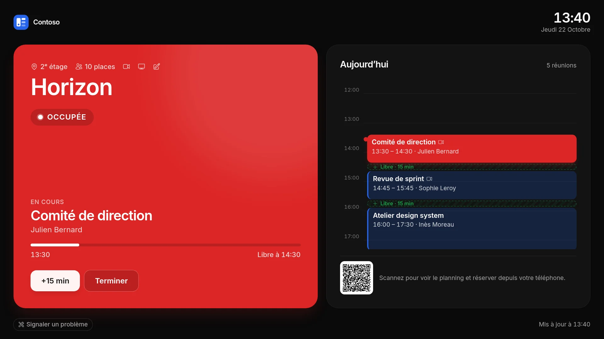
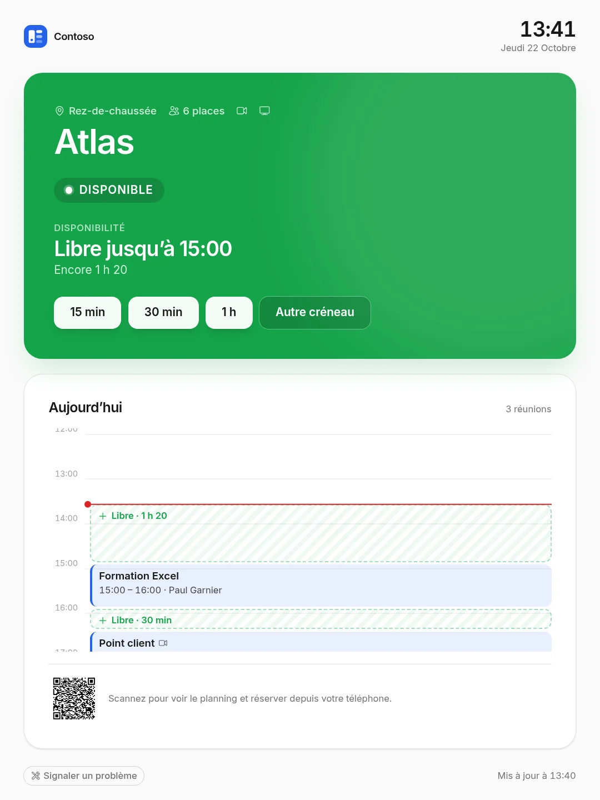
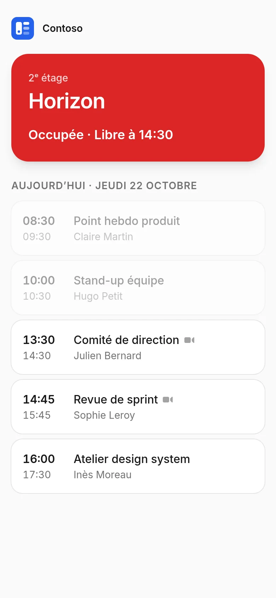

<div align="center">


# O365 Kiosk Resources

**Le planning de vos salles de réunion Microsoft 365, affiché devant chaque salle.**<br />
Écrans muraux et tablettes, réservation sur place, administration complète — en français et en anglais.

[](https://github.com/pokertour/O365KioskResources/actions/workflows/ci.yml)
[](https://github.com/pokertour/O365KioskResources/actions/workflows/release.yml)
[](https://github.com/pokertour/O365KioskResources/tags)


</div>

<p align="center">
  
</p>

<p align="center">
  
  &nbsp;&nbsp;
  
</p>

---

## Sommaire

- [Fonctionnalités](#fonctionnalités)
- [Démarrage rapide (Docker)](#démarrage-rapide-docker)
- [Connecter Microsoft 365](#connecter-microsoft-365)
- [Installer un écran](#installer-un-écran)
- [Administration](#administration)
- [Déploiement](#déploiement)
- [Développement](#développement)
- [Architecture](#architecture)
- [Dépannage](#dépannage)

---

## Fonctionnalités

### 📺 Écrans de salle

- **Statut lisible de loin** : *Disponible*, *Bientôt occupée* ou *Occupée*, aux couleurs de votre marque.
- **Agenda du jour** en **frise** proportionnelle (ligne « maintenant », créneaux libres) ou en **liste**.
- **Réservation sur place** : boutons 15 / 30 / 60 min, créneau libre réservable d'un toucher, modification et annulation des réservations faites depuis l'écran.
- **Terminer ou prolonger** la réunion en cours (+15 / +30 min si la salle reste libre).
- **Adaptatif** : paysage ou portrait, texte dimensionné selon la résolution et la distance de lecture.
- **Mode nuit** hors heures de travail, anti-marquage OLED, réveil au toucher.
- **Kiosque robuste** : écran maintenu allumé, plein écran, zoom bloqué, reprise automatique après une coupure.
- **Annonces** (exercice incendie, travaux…), **équipements** de la salle, **signalement d'un problème**.
- **QR code** vers une vue téléphone signée pour consulter le planning et réserver.
- **Plusieurs écrans par salle**, chacun avec son lien, sa supervision et ses réglages.

### 🛠️ Administration

- **Tableau de bord en direct** : statut de chaque salle, écrans en ligne, signalements ouverts.
- **Import des salles** depuis Microsoft 365, **appairage des écrans par code** à 6 chiffres.
- **Statistiques d'occupation** (7 / 30 / 90 jours) et heures de pointe.
- **Journal d'activité** (réservations, écrans, réglages…), conservé 180 jours.
- **Alertes** par e-mail et/ou **Microsoft Teams** quand un écran ne répond plus ou qu'un problème est signalé.
- **Apparence** : nom, logo, couleurs, thème clair ou sombre, avec aperçu en direct.
- **Réglages** généraux, par salle et par écran : langue, fuseau horaire, format d'heure, durées…
- **Connexion des administrateurs avec Microsoft** (Entra ID, SSO).

### 🔒 Sécurité

- Liens d'écran secrets, stockés hachés et chiffrés, **révocables** écran par écran.
- Droits administrateur revérifiés à chaque action, mot de passe redemandé pour les réglages Microsoft.
- En-têtes de sécurité, pages d'écran en `no-referrer` / `no-store` / `noindex`, logo servi avec une CSP de sandbox.
- Secrets Microsoft et jetons chiffrés en base, double authentification disponible.

---

## Démarrage rapide (Docker)

L'image est publiée sur GitHub Container Registry à chaque version.

```bash
# 1. Générer une clé d'application
docker run --rm ghcr.io/pokertour/o365kioskresources php artisan key:generate --show

# 2. Lancer l'application (SQLite dans un volume)
docker run -d --name salles -p 8080:8080 \
  -e APP_KEY="base64:…" \
  -e APP_URL="http://localhost:8080" \
  -e RUN_MIGRATIONS=true \
  -v salles-storage:/app/storage \
  ghcr.io/pokertour/o365kioskresources:latest

# 3. Créer le premier administrateur
docker exec -it -e ADMIN_EMAIL=vous@entreprise.com -e ADMIN_PASSWORD='un-mot-de-passe-solide' salles php artisan db:seed --force
```

Ouvrez <http://localhost:8080>, connectez-vous, puis [connectez Microsoft 365](#connecter-microsoft-365).
Pour la production (HTTPS, worker, planificateur), voir [Déploiement](#déploiement).

---

## Connecter Microsoft 365

L'application lit et réserve les calendriers des salles via **Microsoft Graph**, avec sa propre identité (*client credentials*) : aucun compte utilisateur n'est nécessaire sur les écrans.

### 1. Inscrire l'application dans Microsoft Entra ID

1. [Microsoft Entra admin center](https://entra.microsoft.com/) › **Applications** › **App registrations** › **New registration**.
2. Nom libre, comptes pris en charge : **Accounts in this organizational directory only**.
3. Notez l'**Application (client) ID** et le **Directory (tenant) ID**.
4. **Certificates & secrets** › **New client secret** : copiez la **valeur** tout de suite.

### 2. Accorder les permissions

**API permissions** › **Add a permission** › **Microsoft Graph**, puis **Grant admin consent** :

| Permission | Type | Obligatoire | Usage |
|------------|------|:-----------:|-------|
| `Calendars.ReadWrite` | Application | ✅ | Lire et réserver les calendriers des salles |
| `Place.Read.All` | Application | — | Importer les salles du locataire |
| `User.Read` | Déléguée | — | Connexion des administrateurs avec Microsoft (présente par défaut) |

> 💡 Recommandé : limitez l'accès de l'application aux seules boîtes de salles avec une [stratégie d'accès application](https://learn.microsoft.com/graph/auth-limit-mailbox-access).

### 3. Saisir les identifiants dans l'application

**Paramètres › Microsoft 365** : ID du locataire, ID d'application, secret client, puis **Enregistrer et tester**.
La carte **Permissions d'API** indique en direct ce qui est accordé ; **Vérifier** prend en compte un consentement donné à l'instant.

### 4. (Facultatif) Connexion des administrateurs avec Microsoft

1. Dans l'inscription d'application › **Authentication**, ajoutez une plateforme **Web** avec l'URI de redirection affichée dans **Paramètres › Microsoft 365** (`https://votre-domaine/auth/microsoft/callback`).
2. Activez **« Se connecter avec Microsoft »**. Seuls les comptes de la page **Administrateurs** ayant les droits administrateur peuvent se connecter (reconnus par leur adresse e-mail).
3. Pour bloquer les autres dès Microsoft : **Applications d'entreprise** › l'application › **Propriétés** › **Affectation requise : Oui**, puis affectez vos administrateurs dans **Utilisateurs et groupes**.

Les mots de passe peuvent ensuite être désactivés, uniquement par un administrateur déjà connecté avec Microsoft (pour éviter de se bloquer).

---

## Installer un écran

1. Créez ou importez la salle dans **Salles** (adresse SMTP de la boîte aux lettres de ressource).
2. Sur la tablette, ouvrez **`https://votre-domaine/kiosk`** : un **code à 6 chiffres** s'affiche.
3. Dans la fiche de la salle › onglet **Écran** › **Ajouter un écran › Avec un code d'association**, saisissez le code et nommez l'écran.
4. La tablette bascule toute seule sur la salle. ✨

Une salle peut avoir plusieurs écrans. Chacun peut être renommé, révoqué, remplacé (nouvelle tablette) ou recevoir ses propres réglages (thème, taille du texte, mode nuit).

> **Conseils matériel** : servez l'application en **HTTPS** (nécessaire pour garder l'écran allumé), activez le mode kiosque / accès guidé de la tablette et désactivez sa mise en veille automatique.

---

## Administration

| Menu | Contenu |
|------|---------|
| **Salles** | Tableau de bord en direct, import Microsoft 365, fiche salle (aperçu, écrans, paramètres, activité) |
| **Statistiques** | Occupation par salle, heures de pointe, réservations faites via l'app |
| **Annonces** | Bandeaux affichés sur tous les écrans ou certains, programmables |
| **Activité** | Journal complet, filtrable par salle, origine et type |
| **Paramètres › Général** | Langue par défaut (FR / EN), fuseau horaire, format 24 h / 12 h, version |
| **Paramètres › Écrans** | Rafraîchissement, taille du texte, alerte « bientôt occupée », frise ou liste, heures de travail, réservation rapide, terminer / prolonger, mode nuit, QR code |
| **Paramètres › Apparence** | Nom, logo (PNG, JPG, WebP, SVG), couleurs, thème des écrans |
| **Paramètres › Notifications** | Délai d'alerte écran hors ligne, e-mail aux administrateurs, canal Teams |
| **Paramètres › Microsoft 365** | Connexion Graph, permissions, connexion Microsoft des administrateurs |
| **Paramètres › Administrateurs** | Comptes, droits, suppression |

Les réglages d'écran se superposent : **écran › salle › réglages généraux**.

---

## Déploiement

### Publier une version

Chaque tag `X.X.X` déclenche [`release.yml`](.github/workflows/release.yml) : tests (Pint + Pest), puis build et publication de l'image avec les tags `X.X.X`, `X.X` et `latest`.

```bash
git tag 1.1.0 && git push origin 1.1.0
```

La version est affichée dans l'administration et sur la page d'accueil (`local-dev` hors image publiée).

> Au premier push, le paquet GHCR est privé : rendez-le public, ou authentifiez le serveur (`docker login ghcr.io`).

### L'image

**FrankenPHP · PHP 8.5**, utilisateur non-root, port **8080**, healthcheck sur `/up`. Une seule image, trois rôles :

| Rôle | Processus | Utilité |
|------|-----------|---------|
| `app` *(défaut)* | `frankenphp run` | Serveur web |
| `worker` | `queue:work` | Envoi des alertes (e-mail, Teams) |
| `scheduler` | `schedule:work` | Détection des écrans hors ligne, nettoyage |

[`compose.example.yaml`](compose.example.yaml) décrit les trois services avec un volume partagé. Placez un reverse proxy HTTPS devant le port 8080, ou donnez un domaine à `SERVER_NAME` pour que FrankenPHP gère lui-même le certificat.

### Variables d'environnement

| Variable | Description |
|----------|-------------|
| `APP_KEY` | **Obligatoire.** Clé de chiffrement (`php artisan key:generate --show`) |
| `APP_URL` | URL publique, ex. `https://salles.example.com` |
| `TRUSTED_PROXIES` | `*` ou IP/CIDR du reverse proxy — nécessaire derrière un proxy (HTTPS, QR codes signés) |
| `RUN_MIGRATIONS` | `true` pour migrer au démarrage du conteneur `app` |
| `DB_*` | SQLite par défaut (`/app/storage/database.sqlite`) ; MySQL / PostgreSQL supportés |
| `MAIL_*` | Serveur d'envoi des alertes |
| `SERVER_NAME` | `:8080` par défaut ; un nom de domaine active le HTTPS automatique |
| `SESSION_SECURE_COOKIE` | `true` en HTTPS |

💾 Le volume **`/app/storage`** contient la base SQLite, le logo et les sessions : **à sauvegarder**.

### Sans Docker

PHP 8.5 (intl, pdo, zip, pcntl), un serveur web pointant sur `public/`, puis :

```bash
composer install --no-dev --optimize-autoloader
npm ci && npm run build
php artisan migrate --force && php artisan optimize
```

Ajoutez un worker (`php artisan queue:work`) et le planificateur (`* * * * * php artisan schedule:run`).

---

## Développement

**Prérequis** : PHP 8.5, Composer, Node.js 22.

```bash
composer setup                 # dépendances, .env, clé, migrations, build
php artisan db:seed            # admin depuis ADMIN_NAME / ADMIN_EMAIL / ADMIN_PASSWORD
composer dev                   # serveur + worker + Vite (http://localhost:8000)
```

| Commande | Rôle |
|----------|------|
| `php artisan test` | Suite de tests (Pest) |
| `vendor/bin/pint` | Formatage du code |
| `php artisan schedule:work` | Planificateur en local (alertes écrans) |
| `php artisan screens:check-offline` | Vérifier les écrans hors ligne manuellement |

La CI ([`ci.yml`](.github/workflows/ci.yml)) lance Pint et les tests à chaque push sur `main` et sur les pull requests.

**Traductions** : les clés sont en anglais dans le code (`__('Rooms')`) ; le français est dans [`lang/fr.json`](lang/fr.json) et `lang/fr/*.php`.

---

## Architecture

| Couche | Technologie |
|--------|-------------|
| Back-end | Laravel 13, Livewire 4 (composants mono-fichier), Fortify |
| Interface | Flux UI, Tailwind CSS 4, Alpine.js |
| Calendriers | Microsoft Graph (client credentials) |
| Runtime | FrankenPHP 8.5 |

```
app/
├── Models/            Room, Screen, AppSetting, BrandingSetting, Announcement, IssueReport, ActivityLog…
├── Services/          MicrosoftGraphService (Graph), RoomSchedule (planning, réservations, statut), RoomStats
├── Http/Controllers/  Logo, langue, connexion Microsoft
└── Console/Commands/  screens:check-offline
resources/views/
├── pages/kiosk/       Écran de salle, appairage
├── pages/admin/       Administration
├── pages/mobile/      Vue téléphone (QR code)
└── components/kiosk/  Frise, liste, horloge…
```

Le planning de chaque salle est mis en cache 20 s (partagé entre tous ses écrans), avec repli sur la dernière version connue si Graph est indisponible, et rejoue les modifications faites depuis l'app tant que Graph ne les reflète pas encore.

---

## Dépannage

| Symptôme | Piste |
|----------|-------|
| « Microsoft 365 n'est pas configuré » | Renseigner **Paramètres › Microsoft 365**. |
| `invalid_client` / 401 | ID d'application ou secret erroné, ou secret expiré. |
| 403 / *Insufficient privileges* | Permission manquante ou consentement non accordé — voir la carte **Permissions d'API**, puis **Vérifier**. |
| 404 sur une salle | L'adresse n'est pas une boîte de salle du même locataire. |
| Import des salles refusé | Ajouter `Place.Read.All` (Application) + consentement. |
| L'écran ne reste pas allumé | Servir l'application en **HTTPS** et désactiver la veille de la tablette. |
| QR code : « lien invalide » | Derrière un proxy, définir `APP_URL` et `TRUSTED_PROXIES`. |
| Pas d'alerte « écran hors ligne » | Le **planificateur** et le **worker** doivent tourner ; vérifier `MAIL_*` / le webhook Teams (**Envoyer un test**). |
| « Ce lien d'écran n'est plus valide » | L'écran a été retiré ou son lien régénéré : réassocier la tablette via `/kiosk`. |

Documentation Microsoft : [permissions Graph](https://learn.microsoft.com/graph/permissions-reference) · [accès sans utilisateur](https://learn.microsoft.com/graph/auth-v2-service-principal).

---

## Licence

MIT — voir [`composer.json`](composer.json).
